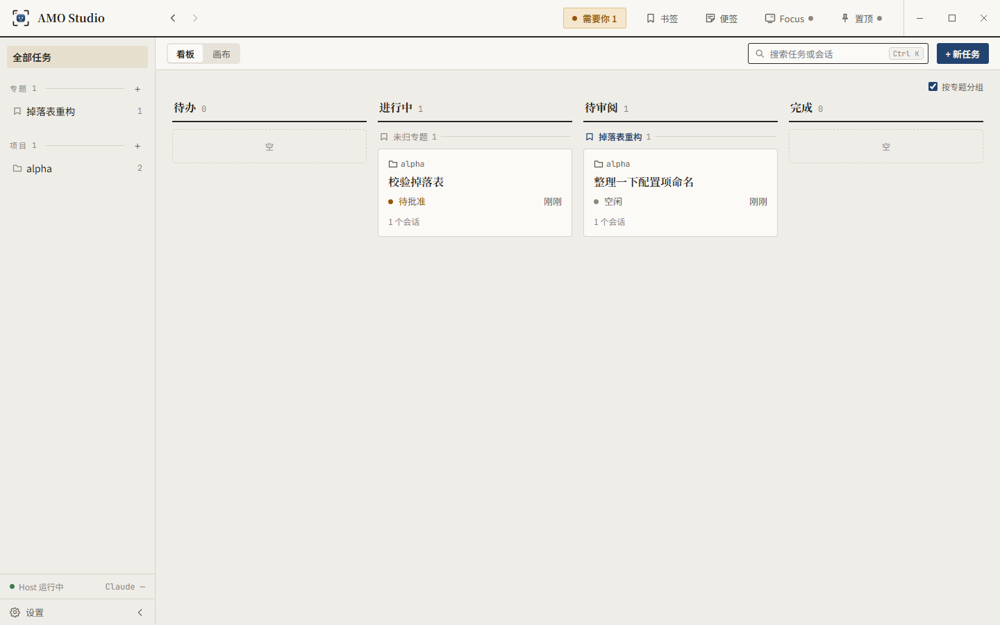
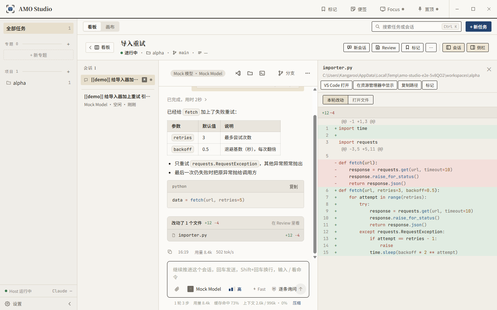
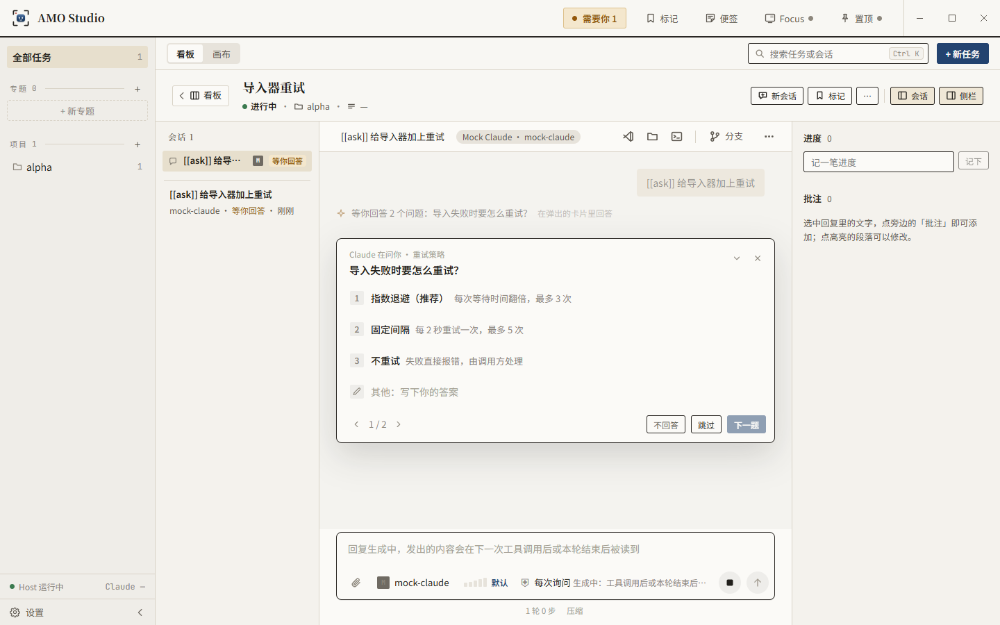
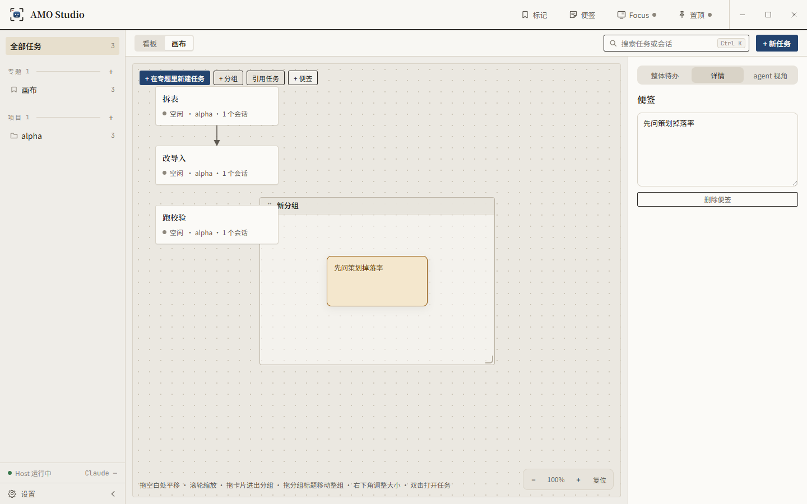
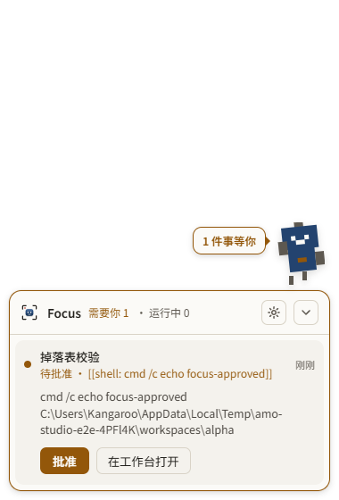
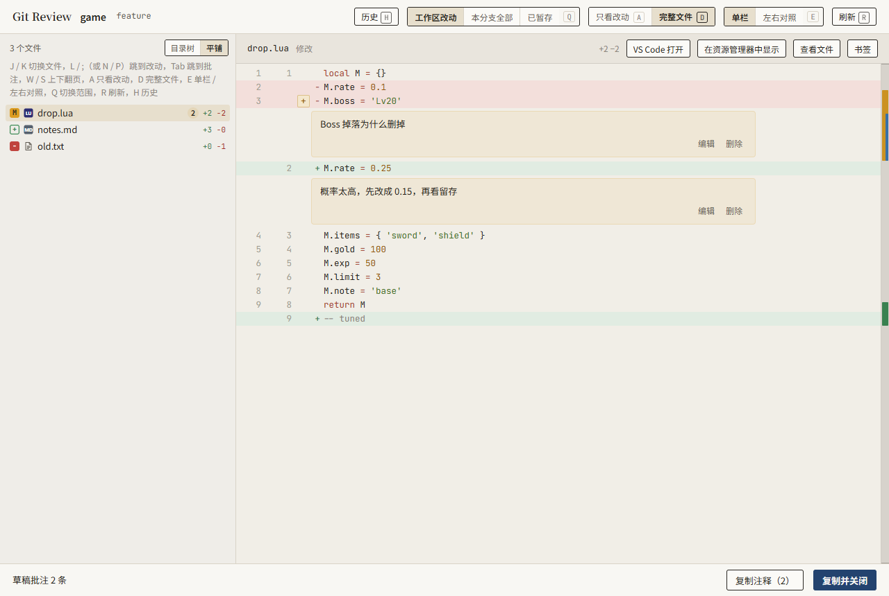
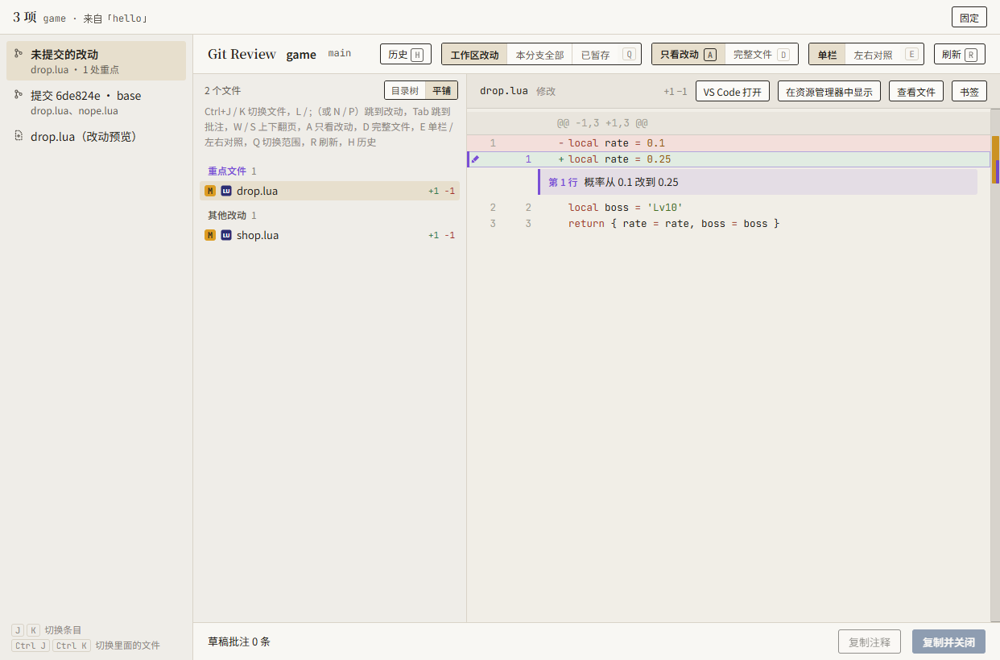
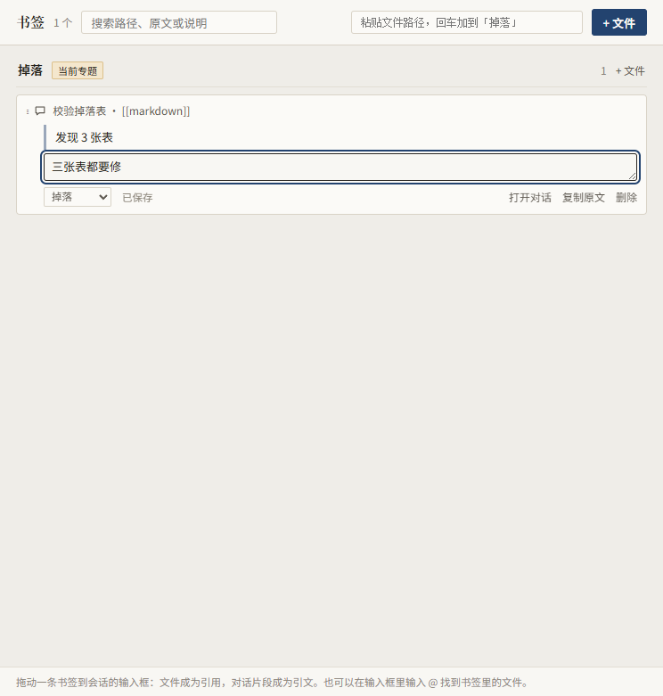
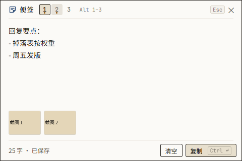

# AMO Studio

AMO Studio 是一个 Windows 桌面工作台，用来推进有 AI agent 参与的项目：人决定做什么、批准什么，agent 在会话里干活。看板管任务，画布看全局，每个任务下面可以开多个和模型的会话（Codex、Claude、DeepSeek）。对话、审批、看改动、写批注，都在同一个工作台里完成。

随它一起的还有两个可以单独使用的小程序：**AMO Reviewer**（Git Review 和查看器）和 **AMO 便签**。



## 功能一览

### 看板：任务和会话

一件事是一个**任务**，看板分为待办、进行中、待审阅、完成四列，列由你来移动。任务卡片上能看到所属项目、会话数，以及有没有在等你批准。左栏按**专题**和**项目**筛选任务；顶栏的「需要你」汇总所有在等你的事。

### 任务页：和模型对话



任务页中间是会话。回复按 markdown 渲染，每一轮改了哪些文件会列在回复下方，点开就能看差异。生成中也可以继续发消息。想换个思路时可以「分支」出新会话，或者另开一个会话换别的模型。型号、思考强度和权限在输入框下方随时切换。需要原版 CLI 时，「在终端打开」会把会话交给终端。

### 审批和提问



agent 要运行命令或改文件时，对话里会出现批准卡片。agent 向你提问时会弹出问题卡片，可以选一个选项，也可以自己写答案。卡片可以收起，选项和没提交的文字都会保留。回复里的任何一段都能选中后写批注，攒够了再一起发回会话。

### 画布：看全局



每个专题有一张无限画布：任务卡片、分组（可以绑定项目）、依赖箭头、便签。侧栏里有「整体待办」，记还没成为任务的事，之后可以一键转成任务。agent 能读画布，但要写画布时每次都需要你批准。

### Focus 悬浮窗



桌面角落的小窗，只列出需要你处理的事：待批准的命令、待回答的问题、调度提案。可以在小窗里直接批准，也可以跳回工作台处理。顶栏的「Focus」按钮开关它。

### Git Review 和查看器



Git Review 可以看工作区改动、整个分支的改动、某个提交或某个范围，支持目录树或平铺、单栏或左右对照，大部分操作都有键盘快捷键。改动行上可以写批注；写完点「复制注释」，把批注连同文件、行号和原文复制出来，贴给需要的 agent。查看器显示单个文件的全文，也能在指定行上写批注。

### 查看包



agent 改完代码，可以把要你看的东西放进一个窗口：未提交的改动、某个提交、改动预览，左边列出各项，右边是内容，标出的重点行附带说明。这样就不用一个个文件去找。

### 书签



对话里的一段话、文件里的一段代码，都可以收进书签，按专题归类，还能加说明。把书签拖到输入框会变成引用，在输入框里输入 `@` 也能找到书签里的文件。

### AMO 便签



一个常驻托盘的便签窗口，全局快捷键（默认 Ctrl+Alt+Space）呼出，用来随手记东西、攒要发给 agent 的话。最多 9 页，用 Alt+数字 切换；可以贴图片；Ctrl+Enter 复制当前页并隐藏窗口。便签是独立进程，Studio 重启也不会关掉它，没有 Studio 也能单独用。

### AMO Reviewer

就是上面的 Git Review 和查看器，但作为一个独立程序：不需要 Studio，也不接模型，任何工具或模型都能用它让人看改动、写批注，批注同样复制后贴回去。用命令行打开某个文件夹，或者定位到某个文件的某几行。

### 另外

- **扩展包**：在项目里放 `.amo/packs/<名字>/pack.json`，提供这个项目的规范文档、流程模板和会话启动预设，格式见 [studio/design/pack-format.md](studio/design/pack-format.md)。只想在本机用、不进项目提交时，在「编辑项目」里点「一键忽略」就能把 `.amo/` 加进 git exclude。
- **agent 之间协作**：受管会话自带 AMO 的 MCP 工具，可以读看板、任务和画布，写自己任务的进度和交接，给别的会话留言，向你提问。它们不能移动看板列，也不能自己开会话。
- **数据在本机**：一个本机后台服务（Host）管理会话和数据，关掉窗口会话也不会断。密钥放在 Windows 凭据管理器里。

## 下载

从本仓库的 **Releases** 下载 Portable 版，解压就能用，不需要安装。有三个包：

| 文件 | 内容 |
|---|---|
| `AMO-Studio-<版本>-portable.zip` | 完整的工作台，包含 AMO Reviewer 和 AMO 便签 |
| `AMO-Reviewer-<版本>-portable.zip` | 只有 AMO Reviewer |
| `AMO-Notes-<版本>-portable.zip` | 只有 AMO 便签 |

解压后双击里面的 exe。Studio 第一次打开时会让你选数据目录，默认是 exe 旁边的 `data` 文件夹，整个文件夹拷走，数据就跟着走。详细说明见 [studio/README.md](studio/README.md)。

目前只支持 Windows。

## 支持的模型

- **Codex**（通过 Codex app-server）：你自己的 GPT 订阅（用本机 Codex 的登录），或 DeepSeek 等兼容渠道。需要先 `npm i -g @openai/codex`。
- **Claude**（通过 Claude Agent SDK）：你自己的 Claude 订阅（默认用本机 Claude Code 的登录，也可以改用 `claude setup-token` 生成的令牌），或 GLM 等兼容渠道。需要先装好 Claude Code（PowerShell 里运行 `irm https://claude.ai/install.ps1 | iex`），Portable 版不自带；没装时这些渠道在 设置 → 模型 里显示为不可用。
- **DSH · DeepSeek**：用你本机的 DeepSeek Harness 源码运行。

渠道和密钥在 设置 → 模型 里配置。

## 从源码运行

需要 Node 24 LTS 和 Git。

```
git clone <本仓库>
cd AgentMonitorOverlay/studio
npm ci
npm start              # 工作台（开发版数据在 studio/.data）
npm run notes          # 单独运行便签
npm run reviewer -- <文件夹>   # 单独运行 Reviewer
```

也可以直接双击 `studio/start-studio.cmd`：它会在需要时安装依赖，然后构建并打开 Studio。

## 文档

- [studio/README.md](studio/README.md)：使用说明、Review 的命令行和接口、常见问题
- [studio/design/architecture.md](studio/design/architecture.md)：架构
- [studio/design/interaction-notes.md](studio/design/interaction-notes.md)：已确认的交互
- [studio/HANDOFF.md](studio/HANDOFF.md)：开发交接

## 许可

[MIT](LICENSE)。第三方组件见 [THIRD_PARTY_NOTICES.md](THIRD_PARTY_NOTICES.md)。
